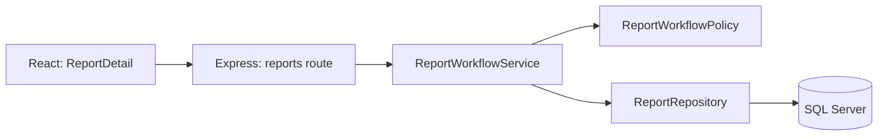
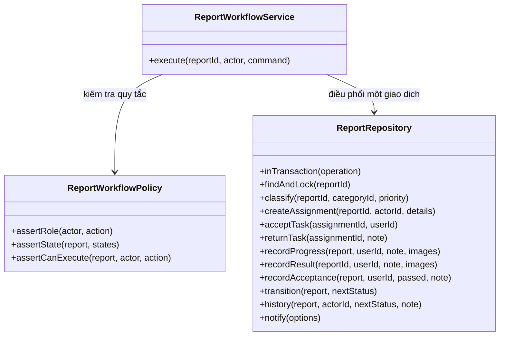

# Kiến trúc và phân bổ trách nhiệm

Ứng dụng triển khai React trong `frontend/`, Express/Node.js trong `backend/` và SQL Server với schema tiếng Việt gốc trong `database/`. Các API dùng tên thuộc tính tiếng Anh thống nhất theo `API-CONTRACT.md`; SQL không chạy ở trình duyệt.

## Luồng xử lý nghiệp vụ chính

| Thành phần thực tế | Trách nhiệm | Không phụ trách |
| --- | --- | --- |
| `frontend/src/pages/ReportDetail.jsx` | Hiển thị dữ liệu, chọn thao tác theo vai trò, thu nhận nội dung/ảnh và gọi API | Không quyết định quyền cuối cùng hoặc tự cập nhật CSDL |
| `backend/src/routes/reports.js` | Đọc yêu cầu HTTP, yêu cầu đăng nhập, gọi service và trả JSON | Không chứa SQL của các lệnh chuyển bước xử lý |
| `backend/src/services/report-workflow.service.js` | Lớp `ReportWorkflowService`: kiểm tra dữ liệu lệnh, phối hợp chính sách, bản ghi nghiệp vụ, lịch sử và thông báo trong một transaction | Không chứa câu truy vấn SQL hoặc phụ thuộc Express |
| `backend/src/services/workflow-policy.js` | Lớp `ReportWorkflowPolicy`: ma trận vai trò, trạng thái hợp lệ và phạm vi đơn vị | Không truy cập CSDL hoặc thay đổi dữ liệu |
| `backend/src/repositories/report.repository.js` | Lớp `ReportRepository`: khóa phản ánh hiện tại, SQL có tham số, bản ghi phân công/tiến độ/kết quả/nghiệm thu và chuyển trạng thái có điều kiện | Không đọc đối tượng request hoặc quyết định thông điệp giao diện |
| `backend/src/report-store.js` | Đọc danh sách/chi tiết, lọc theo phạm vi tài khoản, ẩn vị trí/thông tin riêng tư, các thao tác lưu dùng chung | Không dựa vào việc ẩn nút trên giao diện để cấp quyền |
| `backend/src/db.js` | Connection pool, tham số truy vấn, transaction `SERIALIZABLE`, rollback khi lỗi | Không biết use case hoặc màn hình |

Các API đăng ký, quản trị, thông báo và thống kê được tổ chức thành router riêng. Việc đọc dữ liệu và các thao tác ngoài chuỗi chuyển trạng thái dùng module truy vấn có tham số; các lệnh nghiệp vụ trung tâm dùng các lớp service/policy/repository bên trên.

## Các lớp tham gia trực tiếp

Ví dụ `submit-result`: người dùng phải thuộc đơn vị hiện đang được giao; phản ánh phải là `IN_PROGRESS`; mô tả kết quả và ảnh sau xử lý phải hợp lệ. Service yêu cầu repository thêm `KetQuaXuLy`, lưu ảnh, chuyển sang `WAITING_ACCEPTANCE`, ghi `LichSuTrangThai` và gửi `ThongBao`. Nếu bất kỳ bước nào lỗi, toàn bộ giao dịch được rollback.

## Đối tượng và dữ liệu lưu trữ

Các khái niệm miền nghiệp vụ gồm người dùng/vai trò/đơn vị, phản ánh/loại/ảnh, phân công/tiến độ/kết quả/nghiệm thu, phản hồi/yêu cầu xem xét lại, lịch sử và thông báo. Chúng ánh xạ đến đúng 15 bảng trong schema gốc; không thêm các lớp rỗng chỉ để sao chép bảng dữ liệu. `schema-and-usecases.md` ghi rõ bảng nào tham gia từng UC01–UC16.

## Bảo vệ dữ liệu và truy cập

- Mật khẩu dùng bcrypt; phiên đăng nhập dùng JWT trong cookie `HttpOnly`, `SameSite=Lax`, có cờ `Secure` khi chạy production.
- API kiểm tra nguồn của yêu cầu thay đổi dữ liệu, kiểm tra tài khoản/vai trò/đơn vị còn hoạt động và giới hạn thử đăng nhập.
- Mọi giá trị người dùng trong SQL được truyền qua tham số. Các lệnh chuyển trạng thái khóa bản ghi trước khi kiểm tra lại trạng thái; cập nhật có điều kiện chặn xử lý dựa trên dữ liệu đã cũ.
- Danh sách công khai chỉ công bố phản ánh đã đóng, che chủ sở hữu/vị trí chính xác và nội dung xử lý riêng tư. Người dân và đơn vị chỉ truy cập phản ánh trong phạm vi được cấp.
- Ảnh được kiểm tra chữ ký tệp, giải mã và mã hóa lại thành WebP để loại EXIF/GPS; URL ảnh gắn với người tải và quyền xem phản ánh.

## Kiểm thử

`npm --prefix backend test` kiểm tra quy tắc phân quyền/chuyển trạng thái, phạm vi truy cập, tính khoảng cách, lọc dữ liệu riêng tư, kiểm tra ảnh và biên HTTP. `npm run test:integration` ở thư mục gốc chạy workflow thực tế qua HTTP và SQL Server; cần khởi tạo/seed CSDL trước. Không dùng dữ liệu mô phỏng thay cho SQL Server trong kiểm thử tích hợp.
