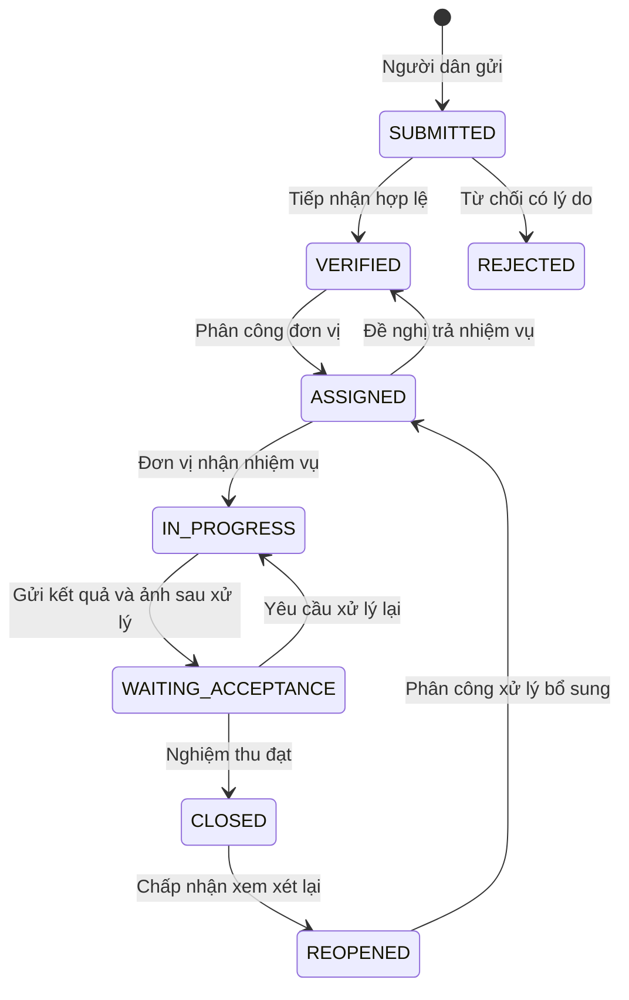

# Ánh xạ yêu cầu và cơ sở dữ liệu

Nguồn yêu cầu là 16 use case trong tài liệu Word và schema SQL Server đính kèm. Các nội dung mô tả trong tài liệu được dùng làm yêu cầu sản phẩm. Tên cột CSDL giữ nguyên tiếng Việt, còn API trả trường tiếng Anh theo `API-CONTRACT.md` để frontend và backend dùng thống nhất.

| Use case | Chức năng | API chính | Bảng chính |
| --- | --- | --- | --- |
| UC01 | Đăng ký người dân | `POST /api/auth/register` | `NguoiDung`, `VaiTro` |
| UC02 | Đăng nhập theo vai trò | `POST /api/auth/login`, `GET /api/auth/me` | `NguoiDung`, `VaiTro`, `DonViXuLy` |
| UC03 | Tạo và gửi phản ánh | `POST /api/uploads`, `POST /api/reports` | `PhanAnh`, `HinhAnhPhanAnh`, `LichSuTrangThai`, `ThongBao` |
| UC04 | Kiểm tra trùng | `POST /api/reports/check-duplicates` | `PhanAnh`, `KiemTraTrung` |
| UC05 | Theo dõi phản ánh và lịch sử | `GET /api/reports`, `GET /api/reports/:id` | `PhanAnh`, `PhanCong`, `DonViXuLy`, `LichSuTrangThai`, `vw_PhanAnhTheoDoi` |
| UC06 | Đánh giá kết quả | `POST /api/reports/:id/feedback` | `PhanHoi`, `PhanAnh` |
| UC07 | Yêu cầu xem xét lại | `POST /api/reports/:id/reopen` | `YeuCauXemXetLai`, `PhanHoi`, `ThongBao` |
| UC08 | Tiếp nhận, phân loại, từ chối | `POST /api/reports/:id/actions` (`verify`, `reject`) | `PhanAnh`, `LoaiPhanAnh`, `LichSuTrangThai` |
| UC09 | Phân công và thời hạn | `POST /api/reports/:id/actions` (`assign`) | `PhanCong`, `DonViXuLy`, `PhanAnh` |
| UC10 | Tiếp nhận hoặc trả nhiệm vụ | `POST /api/reports/:id/actions` (`accept-task`, `return-task`) | `PhanCong`, `PhanAnh`, `LichSuTrangThai` |
| UC11 | Cập nhật tiến độ và ảnh | `POST /api/reports/:id/actions` (`progress`) | `TienDoXuLy`, `PhanCong` |
| UC12 | Gửi kết quả để nghiệm thu | `POST /api/reports/:id/actions` (`submit-result`) | `KetQuaXuLy`, `HinhAnhPhanAnh`, `PhanAnh` |
| UC13 | Nghiệm thu hoặc yêu cầu làm lại | `POST /api/reports/:id/actions` (`accept-result`, `rework`) | `NghiemThu`, `KetQuaXuLy`, `PhanAnh`, `PhanCong` |
| UC14 | Chấp nhận hoặc từ chối xem xét lại | `GET /api/reopens`, `POST /api/reopens/:id/decision` | `YeuCauXemXetLai`, `PhanAnh`, `LichSuTrangThai`, `ThongBao` |
| UC15 | Quản lý danh mục, đơn vị | `/api/admin/categories`, `/api/admin/units` | `LoaiPhanAnh`, `DonViXuLy` |
| UC16 | Báo cáo có bộ lọc | `GET /api/stats` | `PhanAnh`, `PhanCong`, `LoaiPhanAnh`, `PhanHoi`, `vw_BaoCaoPhanAnh` |

Ngoài các use case, hệ thống có thông báo theo người dùng, đánh dấu đã đọc và quản lý vai trò/tình trạng tài khoản. Backend kiểm tra vai trò ở mỗi API; việc ẩn nút trên giao diện không thay thế phân quyền phía máy chủ.

## Chuỗi trạng thái

Mỗi lần gửi kết quả có một dòng `KetQuaXuLy`; mỗi kết quả được nghiệm thu một lần theo ràng buộc duy nhất trên `NghiemThu.MaKetQua`. Nếu cần làm lại, đơn vị gửi kết quả mới. Một phản ánh được phân công nhiều lần và chỉ có một yêu cầu xem xét lại `PENDING` tại một thời điểm.

## Vị trí, quyền riêng tư và kiểm tra trùng

Schema gốc lưu `PhanAnh.ToaDo` dạng `latitude,longitude`. Backend phân tích, kiểm tra phạm vi vĩ độ/kinh độ, tính khoảng cách Haversine và so sánh phản ánh cùng loại trong bán kính 200 m, gửi trong 30 ngày và chưa kết thúc. Cảnh báo trùng cho phép người dân xác nhận tiếp tục; không tự động gộp hoặc xóa nội dung.

Danh sách công khai chỉ chứa phản ánh đã `CLOSED`; không trả thông tin liên hệ người gửi, mã chủ sở hữu, vị trí chính xác hoặc ghi chú nội bộ. Người dân xem phản ánh của mình; cán bộ và đơn vị xem thông tin cần thiết theo phạm vi nhiệm vụ. Ảnh tải lên phải được kiểm tra kiểu dữ liệu, dung lượng và quyền truy cập, khác với ảnh minh họa công khai của bộ seed.

## Tính nhất quán dữ liệu

Các thay đổi nghiệp vụ liên quan nhiều bảng cần cùng transaction: kiểm tra trạng thái hiện tại, cập nhật phản ánh, lưu bản ghi nghiệp vụ, ghi lịch sử và tạo thông báo. CSDL dùng khóa ngoại và các ràng buộc `CHECK` từ schema gốc để chặn giá trị trạng thái không hợp lệ. API dùng câu truy vấn có tham số cho dữ liệu đầu vào.

Các chỉ mục gốc hỗ trợ lọc người gửi, loại, trạng thái, đơn vị, thời điểm và thông báo chưa đọc. Không thay đổi bản SQL đính kèm; mọi thay đổi schema về sau cần migration riêng có phiên bản và kế hoạch sao lưu.
